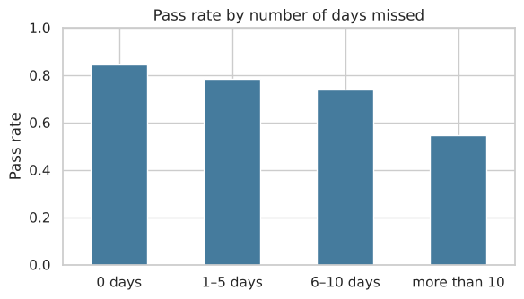
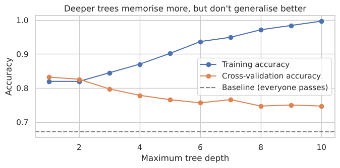
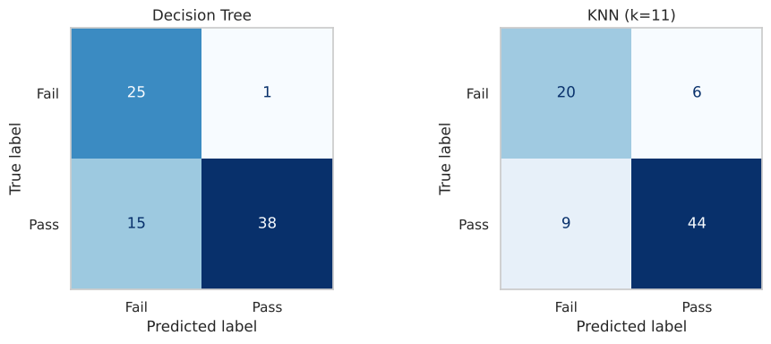

#  Early Warning: Predicting Which Students Need Help

A beginner machine learning project that predicts, **after the first term**, whether a student will **pass or fail** the final maths exam, so teachers can step in while there's still time. It compares a **Decision Tree** and **K-Nearest Neighbors (KNN)**.

Built by **Joanne** 

---

##  Project Overview

Teachers usually find out a student has failed only after the final exam. This project asks whether information available **after term 1** (the first-term grade, attendance, past failures, study habits and background) can flag at-risk students early.

It also connects to my hardware project **SmartAttend** (an RFID attendance system): if we collect attendance data, does it actually predict results?

**Workflow:**
1. Load and explore the data
2. Investigate a data quirk (students recorded with a final grade of 0 and 0 absences)
3. Encode features and split into train/test sets
4. Build and tune a Decision Tree and KNN, using cross-validation to choose settings
5. Compare against a baseline with accuracy, cross-validation and confusion matrices

##  Dataset

- **Name:** UCI Student Performance Dataset (Maths)
- **Link:** https://archive.ics.uci.edu/dataset/320/student+performance
- **Size:** 395 students × 33 columns, no missing values
- **Target:** `passed` = 1 if final grade `G3` ≥ 10 / 20, else 0 (67% pass)
- A copy of the dataset (`student-mat.csv`) is included in this repository.

##  Repository Structure
student-performance/
├── student_performance_prediction.ipynb   
├── student-mat.csv                        
├── *.png                                  
├── requirements.txt
└── README.md

##  Setup Instructions

```bash
git clone https://github.com/Joannebjomy/student-performance.git
cd student-performance
pip install -r requirements.txt
jupyter notebook student_performance_prediction.ipynb
```
Then choose **Kernel → Restart & Run All**.

##  Key Findings from the Data

- **38 students have a final grade of 0, and all 38 have 0 absences.** They most likely dropped out. I kept them as fails, because an early-warning system should catch them, but excluded them from the attendance analysis.
- **Attendance matters:** the pass rate falls from **84%** (no absences) to **55%** (more than 10 days missed).



- **Past failures** are a strong warning sign: 75% pass with no past failures vs 18% with two.

##  Models

| | Decision Tree | KNN |
|---|---|---|
| Features | All 40 (after encoding), with `G2` hidden | 1st-term grade, absences, past failures (scaled) |
| Tuning | `max_depth` chosen by 5-fold CV → **1** | `k` chosen by 5-fold CV → **11** |
| Key lesson | An unlimited tree overfits: 100% train, 77% test | With all 40 features it's no better than the baseline |



## Results

| Model | Test accuracy | 5-fold CV | Failing students caught | False alarms |
|---|---|---|---|---|
| Baseline (everyone passes) | 67.1% | — | 0 / 26 | 0 |
| Decision Tree | 79.7% | 81.0% | **25 / 26** | 15 |
| KNN (k = 11) | **81.0%** | **86.6%** | 20 / 26 | 9 |



##  Conclusion

Both models clearly beat the baseline, but they're good at different things, so **the better model depends on the school**:

- **KNN** is more accurate and more reliable across folds, raises fewer false alarms, and uses attendance. It's best when teachers' time is limited.
- **The Decision Tree** catches 25 of 26 failing students with a one-sentence rule (*"below 10.5 after term 1 → at risk"*). It's best when a school can afford extra check-ins and never wants to miss a student.

Since missing a struggling student costs more than a false alarm, I'd lean towards the Decision Tree for an early-warning system.

### What I learned
- Always compare against a baseline.
- Investigate anything strange in the data. The "0 absences" quirk turned out to be likely dropouts.
- Overfitting is real, and cross-validation is how you catch it.
- KNN needs scaling and carefully chosen features.
- Accuracy isn't everything: confusion matrices show *which* mistakes a model makes.

##  Tech Stack
Python · pandas · NumPy · scikit-learn · matplotlib · seaborn · Jupyter
